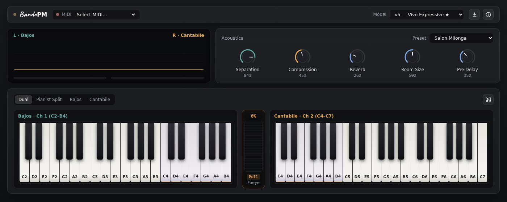

# BandoPM — Bandoneon Physical Modeling Synthesizer

**BandoPM** is a real-time, physics-informed bandoneon physical modeling synthesizer written in **Rust**, designed specifically for the **[Bandolibre](https://bandolibre.github.io)** open-source MIDI bandoneon controller.

It runs in the browser (`WebAssembly` + `AudioWorklet` + `WebMIDI`) as an installable **PWA**: nothing to install, on computers, tablets and phones.

---

## Core Highlights

1. **Tailored for Bandolibre**:
   - Processes `Note On` / `Note Off` with initial velocity determined by the bellows blade sensor, and continuous `CC#11` (Expression) representing instantaneous bellows pressure.
2. **Physical Modeling First**:
   - Models the self-sustained oscillation of **blown-closed free reeds** driven by unsteady Bernoulli airflow, paired octave reed activation thresholds ($8'$ and $4'$ reeds), mechanical valve noises, and wooden enclosure resonances.
   - Incorporates insights from the **Bandoneon 2.0** research group (Universidad Nacional de Quilmes) on pressure thresholds and physics-informed synthesis.
3. **Calibrated on Real Recordings**:
   - `synth-eval` scores the model against golden bandoneon recordings and tunes its parameters.
4. **Runs Everywhere**:
   - A portable Rust DSP core (`synth-core`) compiled to WebAssembly, so it plays in any modern browser.
