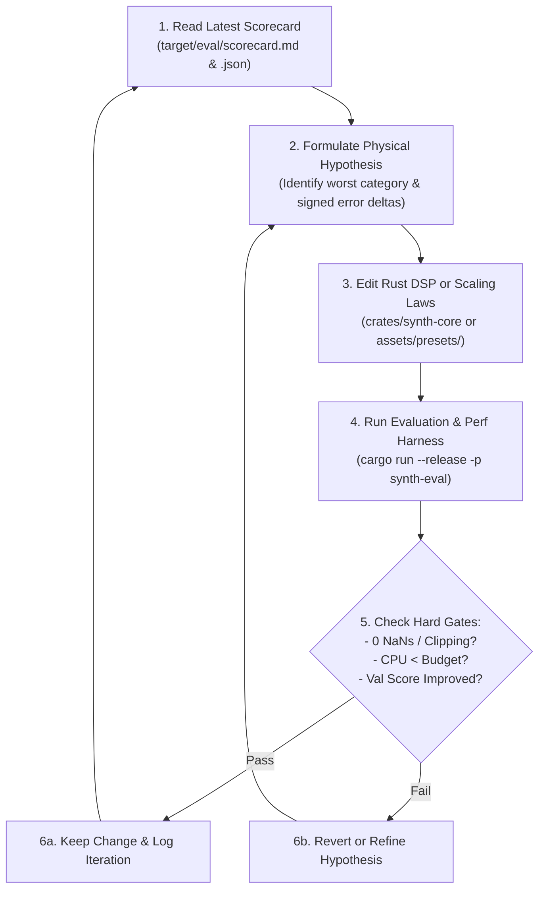
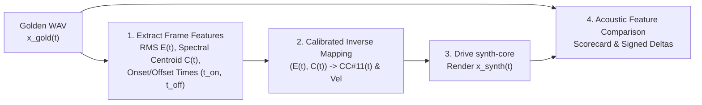

# Autonomous AI Evaluation & Iteration Architecture (`EVALUATION.md`)

This document specifies the **test-driven, metric-guided autonomous iteration loop** for developing the Bandolibre physical modeling synthesizer.

Because an AI coding agent cannot "listen" to audio in real time, this repository replaces subjective ear-tuning with an **Automated Acoustic Oscilloscope & Scorecard (`synth-eval`)**. In a **Single-Loop Architecture**, the AI agent directly modifies both the **Rust DSP equations (`synth-core`)** and the **physical parameter presets**, guided by a structured multi-tier scorecard comparing synthesized audio against golden recordings of a real bandoneon.

---

## 1. The Autonomous Hill-Climbing Loop

Every DSP or parameter iteration performed by an AI agent follows a strict scientific loop:



### Why Single-Loop Works Here: Signed Physical Error Deltas
If the evaluation tool only output a single scalar loss (e.g., `Loss: 0.412`), the AI would be forced to guess blindly. Instead, `synth-eval` outputs **signed physical deltas** alongside the loss score:
- *Bad feedback*: `harmonic_loss = 0.52`
- *Actionable feedback*: `H2_error_at_p = -9.4 dB (synth 4' octave reed is too quiet at low pressure; lower P_th_4 or increase 4' orifice coupling)`

This allows an LLM agent to reason directly from acoustics and mechanics to code and parameter adjustments in a single step.

---

## 2. Golden Dataset & Train/Validation Split

### 2.1 Target Sample Types
The golden dataset (`assets/samples/golden/`) consists of standard **microphone audio recordings (`.wav`)** of an acoustic bandoneon playing isolated single notes across registers (Low, Mid, High) under two primary articulation classes:
1. **Steady Dynamics (`p`, `mf`, `ff`)**: Sustained notes held at soft, medium, and loud bellows pressure.
2. **Staccato & Marcato Attacks (`staccato`, `marcato`)**: Crisp, accented note onsets capturing pallet valve clicks, initial reed tongue chirp, chamber pressure spike, and release decay.

### 2.2 File Naming & Manifest Convention
Samples are indexed in `assets/samples/golden/manifest.json` with standardized metadata:
```text
assets/samples/golden/
├── manifest.json
├── train/
│   ├── C3_cerrando_p.wav
│   ├── C3_cerrando_mf.wav
│   ├── C3_cerrando_ff.wav
│   ├── C3_cerrando_marcato.wav
│   ├── G3_abriendo_p.wav
│   └── ...
└── val/
    ├── D#3_cerrando_p.wav
    ├── D#3_cerrando_ff.wav
    ├── A4_abriendo_marcato.wav
    └── ...
```

### 2.3 Anti-Overfitting Guardrails
Because the AI agent edits both DSP code and parameter presets in a single loop, we enforce two strict guardrails against "metric hacking" (such as hardcoding per-sample wavetables or overfitting specific WAV files):

1. **Train / Validation Split Across Pitches**:
   - **Train Set (`train/`)**: Used to print detailed per-note, per-harmonic signed error diagnostics in the scorecard.
   - **Validation Set (`val/`)**: Held-out notes at intermediate pitches and dynamics. Only the aggregate validation sub-scores are reported. **A change is only accepted if the Validation Composite Score improves (or stays within $0.5\%$ while Train improves).**
2. **Smooth Physical Scaling Regularization ($L_{\text{reg}}$)**:
   - Physical reed parameters ($f_0$ stiffness, damping $Q$, threshold pressures $P_{\text{th}, 8'}, P_{\text{th}, 4'}$, orifice area $S_{\text{eff}}$, chamber resonance $f_{\text{chamber}}$) **must be expressed as smooth functions of MIDI pitch / reed length** (e.g., power-law or cubic spline across the compass).
   - If per-note trim offsets $\delta_n$ are used, the evaluator adds a second-difference roughness penalty:
     $$L_{\text{reg}} = \lambda_{\text{smooth}} \sum_{n} \left\| \theta_{n+1} - 2\theta_n + \theta_{n-1} \right\|_2^2$$
     This mathematically prevents jagged per-note lookup table hacks.

---

## 3. Envelope Inversion: Driving the Synth from Audio-Only WAVs

Because the golden recordings contain **audio only** (without a physical pressure sensor inside the acoustic bellows), the test harness uses **Envelope Inversion** to reconstruct the deterministic control stream (`Note On` velocity + continuous `CC#11(t)` + `Note Off`) that drives `synth-core`:



### Step-by-Step Inversion Protocol
1. **Onset & Offset Detection ($t_{\text{on}}, t_{\text{off}}$)**:
   - Detects the exact sample frame where key click / acoustic energy begins ($t_{\text{on}}$) and where the pallet closes ($t_{\text{off}}$).
2. **Loudness & Brightness Trajectory Extraction**:
   - Computes short-time RMS amplitude $A_{\text{gold}}(t)$ (using a $5\text{ ms}$ causal window) and normalized spectral centroid $C_{\text{gold}}(t)$.
3. **Mapping to Control Stream (`CC#11(t)` and `velocity`)**:
   - During calibration initialization, `synth-eval` measures the synth's steady-state monotonic transfer curve $A_{\text{synth}}(\text{CC11})$ for the target pitch.
   - For every control frame ($1\text{ ms}$ step), `synth-eval` inverts the transfer curve:
     $$\text{CC11}(t) = \text{ clamp}\left( A_{\text{synth}}^{-1}\left(A_{\text{gold}}(t)\right),\, 0,\, 127 \right)$$
   - **`Note On` Velocity**: Derived from the initial slope $\left.\frac{d A_{\text{gold}}}{dt}\right|_{t_{\text{on}}}$ and peak amplitude in the first $25\text{ ms}$ after $t_{\text{on}}$ (capturing whether the note was struck as a sharp *marcato* or a soft *p* entry).
4. **Time-Aligned Rendering**:
   - `synth-core` renders $x_{\text{synth}}(t)$ at the exact sample rate of $x_{\text{gold}}(t)$, ensuring that every time slice $t$ compares the synth and the real bandoneon at matched acoustic power.

---

## 4. Hierarchy of Acoustic Fidelity Metrics

The Composite Acoustic Loss $L_{\text{total}}$ is a weighted sum of **5 domain-specific sub-metrics**, ordered by perceptual and physical priority:

$$L_{\text{total}} = 0.35 \, L_{\text{harmonic}} + 0.25 \, L_{\text{transient}} + 0.20 \, L_{\text{dual\_reed}} + 0.10 \, L_{\text{pitch}} + 0.10 \, L_{\text{body}} + L_{\text{reg}}$$

We also report an intuitive **Composite Fidelity Score** from `0.0` to `100.0`:
$$\text{Score} = 100 \cdot \exp\left(-L_{\text{total}}\right)$$

---

### Priority 1: Harmonic Profile & Spectral Balance ($35\%$ Weight)
Measures how accurately the free-reed orifice nonlinearity reproduces the rich harmonic spectrum across `p`, `mf`, and `ff` dynamics.
- **Calculation**:
  - Pitch-synchronous harmonic extraction measures the log-decibel amplitude of the first $K = 32$ harmonics ($H_1 \dots H_{32}$, where $H_1 = f_0/2$ or $f_0$ depending on $8'$ fundamental) normalized to total frame energy:
    $$L_{\text{harmonic}} = \frac{1}{K} \sum_{k=1}^{K} w_k \left| \text{dB}\left(H_k^{\text{synth}}\right) - \text{dB}\left(H_k^{\text{gold}}\right) \right|$$
    with perceptual weighting $w_k$ emphasizing $H_1 \dots H_{16}$ and high-frequency spectral tilt ($1\text{–}6\text{ kHz}$ "bite").
- **Signed Diagnostics for AI**:
  - Per-harmonic dB error vector (`H1_err_db` .. `H16_err_db`) at `p`, `mf`, and `ff`.
  - `spectral_centroid_err_hz`: Positive means synth is too bright/buzzy; negative means synth is too dull/muffled.
  - `odd_to_even_ratio_err_db`: Direct indicator of reed frame symmetry ($y_0$ resting gap offset).

---

### Priority 2: Attack & Release Transients ($25\%$ Weight)
Measures the dynamic responsiveness of reed startup (hopf bifurcation across $P_{\text{th}}$), initial tongue chirp, and pallet valve articulation.
- **Calculation**:
  - **Attack Rise Time ($\Delta t_{10\to 90}$)**: Error in milliseconds for the envelope to rise from $10\%$ to $90\%$ on `staccato` and `marcato` samples.
  - **Multi-Resolution Onset STFT Distance**: High-time-resolution ($2\text{ ms}$, $5\text{ ms}$, $10\text{ ms}$ windows) log-spectral convergence over the first $80\text{ ms}$ of note onset and first $80\text{ ms}$ of note release.
  - **Onset Transient Overshoot Ratio**: Ratio of peak attack energy to steady-state sustain energy in `marcato` articulations.
- **Signed Diagnostics for AI**:
  - `attack_rise_time_err_ms`: Positive means synth reed starts oscillating too slowly (damping too high or piston coupling $S_{\text{piston}}$ too weak).
  - `click_energy_err_db`: Pre-oscillation broadband impulse energy error ($0\text{–}15\text{ ms}$).

---

### Priority 3: Dual-Reed ($8'$ + $4'$) Interaction ($20\%$ Weight)
Captures the hallmark bandoneon pairing of the fundamental ($8'$) and octave ($4'$) reeds sharing a chamber.
- **Calculation**:
  - **Octave Balance Trajectory**: Ratio of $4'$ reed energy (even harmonics $2f_0, 4f_0, \dots$) to $8'$ reed energy (odd harmonics $f_0, 3f_0, 5f_0$) across `p`, `mf`, and `ff`.
  - **Low-Pressure Sequential Activation**: Difference in onset delay $\Delta t_{8'\text{ vs }4'}$ during soft `p` entries (verifying that one reed speaks slightly before the other as pressure crosses $P_{\text{th}, 1}$ then $P_{\text{th}, 2}$).
  - **Octave Beating / Amplitude Modulation**: Envelope modulation depth and beating rate ($\text{Hz}$) at $2f_0$ caused by slight natural detuning and chamber pressure coupling.
- **Signed Diagnostics for AI**:
  - `octave_4ft_to_8ft_err_db` at `p`, `mf`, `ff`.
  - `beat_freq_err_hz`: Difference in slow amplitude modulation rate during sustained notes.
  - `dual_reed_onset_lag_err_ms`: Difference between $8'$ and $4'$ startup delay.

---

### Priority 4: Pressure-Induced Pitch Bend ($10\%$ Weight)
Captures the subtle aerodynamic frequency shift (typically a slight flattening of $3\text{–}15\text{ cents}$ as bellows pressure increases from `p` to `ff` or during a hard `marcato` stab).
- **Calculation**:
  - High-precision autocorrelation / YIN pitch tracker extracts $f_0(t)$ in cents relative to nominal pitch at `p`, `mf`, `ff`, and during `marcato` attacks:
    $$L_{\text{pitch}} = \left| \Delta c_{\text{p}\to\text{ff}}^{\text{synth}} - \Delta c_{\text{p}\to\text{ff}}^{\text{gold}} \right| + \left| \Delta c_{\text{attack}}^{\text{synth}} - \Delta c_{\text{attack}}^{\text{gold}} \right|$$
- **Signed Diagnostics for AI**:
  - `pitch_bend_p_to_ff_err_cents`: Tells the AI how much to adjust the aerodynamic compliance coupling term in the reed ODE.

---

### Priority 5: Wooden Body & Bellows Resonance ($10\%$ Weight)
Measures the broad formant filtering of the wooden *cabezal* and the breathy inter-harmonic air turbulence noise.
- **Calculation**:
  - **Spectral Envelope Formant Distance**: Cepstral / smoothed LPC envelope distance ($100\text{ Hz}\text{–}5\text{ kHz}$), insensitive to individual harmonic peaks, measuring whether the global body resonator matches the woody peaks and notches of the real instrument.
  - **Harmonic-to-Noise Ratio (HNR)**: Compares the broadband inter-harmonic air hiss floor between harmonic peaks.
- **Signed Diagnostics for AI**:
  - `formant_band_err_db`: Signed dB error across 8 perceptual bark/octave bands ($125\text{ Hz}, 250\text{ Hz}, 500\text{ Hz}, 1\text{ kHz}, 2\text{ kHz}, 4\text{ kHz}, \dots$) to directly guide tuning of the body modal biquad bank.
  - `air_noise_floor_err_db`: Positive means too much air turbulence noise; negative means too sterile/clean.

---

## 5. Native CPU Performance & Stability Gates

Per architectural decision, **fast native Rust CPU benchmarks** gate every iteration in the inner loop:

1. **Quantum Render Benchmark (`48 kHz`, 128-sample AudioWorklet quantum = $2666.7\ \mu\text{s}$ real-time budget)**:
   - `1_voice_us_per_quantum`: Time to render 1 active note (2 coupled reeds + body filter). Target: **$< 25\ \mu\text{s}$** ($< 1\%$ real-time).
   - `16_voices_us_per_quantum`: Time to render 16 simultaneous voices (32 coupled reeds + body filter). Hard Gate: **$< 350\ \mu\text{s}$** native ($\approx 13\%$ of one core, leaving comfortable headroom for `wasm32` execution in a browser `AudioWorklet`).
2. **Numerical Stability Stress Test**:
   - Runs a 2-second torture sequence (rapid `CC#11` step jumps $0 \to 127 \to 0$, velocity 127 stabs, 16-voice polyphonic cluster, silence decay).
   - **Hard Gate**: Zero `NaN`s, zero `Inf`s, peak output bounded within $[-1.0, 1.0]$ (with limiter/saturation), DC offset $< -60\text{ dBFS}$, and decay to $< -90\text{ dBFS}$ within $500\text{ ms}$ of `CC#11 = 0`.

---

## 6. Structured Scorecard Schema (`target/eval/scorecard.json`)

Every run of `cargo run --release -p synth-eval` (or `cargo run --release -p synth-eval -- diagnose` for detailed per-manual, per-dynamic, and per-pitch-region error breakdowns) writes both a human/LLM-friendly Markdown summary (`target/eval/scorecard.md`) and a machine-readable JSON file (`target/eval/scorecard.json`).

### Baseline (`v1`) vs. SOTA Physical Model (`v2`) Evaluation Progression
Across all 328 golden Alfred Arnold bandoneon recordings (`219 train`, `109 held-out val`), advancing from the baseline odd-clipper model (`v1`) to the SOTA physical model (`v2`: Rationalized Conjugate 1st-Order ADAA + Millot-Baumann Two-Sided Slot Constriction + Cottingham Transient Harmonic Bloom + Finite-Box Baffle Diffraction + Intra-Celda 1:2 Mode Locking + Dual-Box Modal Resonators) achieved the following verified improvements with zero regularization penalty ($L_{\text{reg}} = 0.0000$):

| Metric / Evaluation Tier | Weight | `v1` Train | `v2` Train | `v1` Val | `v2` Val | Improvement (Train / Val) |
| :--- | :---: | :---: | :---: | :---: | :---: | :---: |
| **Composite Fidelity Score** | **100%** | **58.42** | **65.87** | **57.91** | **64.25** | **`+7.45` / `+6.34`** |
| 1. Harmonic Profile & Balance | 35% | 51.78 | 62.66 | 53.56 | 62.23 | `+10.88` / `+8.67` |
| 2. Attack & Release Transients | 25% | 56.29 | 63.01 | 56.00 | 64.86 | `+6.72` / `+8.86` |
| 3. Dual-Reed ($8' + 4'$) Coupling | 20% | 60.84 | 63.14 | 55.14 | 56.60 | `+2.30` / `+1.46` |
| 4. Pressure-Induced Pitch Bend | 10% | 82.64 | 87.38 | 81.87 | 81.87 | `+4.74` / `0.00` |
| 5. Wooden Body & Bellows Formants | 10% | 63.80 | 71.97 | 64.62 | 70.90 | `+8.17` / `+6.28` |

All hard stability and real-time CPU gates pass (`291.55 us` for 16 active voices / 32 coupled reeds per 128-sample quantum at `48 kHz`, well inside the `< 350 us` budget).

```json
{
  "timestamp": "2026-10-22T05:15:00Z",
  "git_commit": "a1b2c3d",
  "gates": {
    "passed_all": true,
    "stability_no_nan_or_inf": true,
    "silence_convergence": true,
    "cpu_budget_passed": true
  },
  "performance": {
    "sample_rate_hz": 48000,
    "quantum_samples": 128,
    "realtime_quantum_us": 2666.7,
    "voice_1_us_per_quantum": 14.2,
    "voice_16_us_per_quantum": 198.5,
    "voice_16_budget_us": 350.0
  },
  "scores": {
    "composite_train_score": 74.8,
    "composite_val_score": 73.1,
    "regularization_penalty": 0.012,
    "categories": {
      "1_harmonic_profile": { "score": 78.2, "weight": 0.35 },
      "2_transients":       { "score": 68.4, "weight": 0.25 },
      "3_dual_reed":        { "score": 71.0, "weight": 0.20 },
      "4_pitch_bend":       { "score": 82.5, "weight": 0.10 },
      "5_body_resonance":   { "score": 76.0, "weight": 0.10 }
    }
  },
  "diagnostics_signed_deltas": {
    "harmonic_profile": {
      "spectral_centroid_err_hz": { "p": -180.0, "mf": -95.0, "ff": 40.0 },
      "h1_to_h8_err_db_at_mf": [0.0, -4.2, -1.8, -5.1, -0.9, -3.4, -2.1, -4.8]
    },
    "transients": {
      "attack_rise_time_err_ms": { "staccato": 11.5, "marcato": 8.2 },
      "pallet_click_err_db": -6.5
    },
    "dual_reed": {
      "octave_4ft_to_8ft_err_db": { "p": -7.8, "mf": -3.1, "ff": -0.8 },
      "beat_freq_err_hz": -0.45,
      "dual_reed_onset_lag_err_ms": 14.0
    },
    "pitch_bend": {
      "drift_p_to_ff_err_cents": 4.2
    },
    "body_resonance": {
      "octave_band_err_db": {
        "125Hz": 1.2, "250Hz": -3.8, "500Hz": -5.4, "1kHz": 0.6, "2kHz": 2.9, "4kHz": -1.5
      },
      "air_noise_floor_err_db": -8.0
    }
  },
  "top_actionable_recommendations": [
    "Dual-Reed (p): 4' octave reed (even harmonics H2, H4, H8) is -7.8 dB too weak at soft dynamics; lower 4' threshold pressure P_th_4ft by ~15%.",
    "Transients: Marcato attack rise time is +8.2 ms too slow; increase reed piston area coupling S_piston or reduce valve opening time constant.",
    "Body Resonance: -5.4 dB dip around 500 Hz; boost body modal resonator mode near 480-520 Hz."
  ]
}
```
