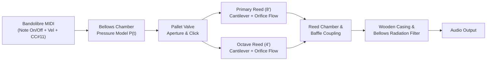

# Project Vision: Bandolibre Physical Modeling Synthesizer

## 1. Executive Summary

The goal of this project is to build an expressive, ultra-low-latency **bandoneon sound synthesizer** tailored for the **[Bandolibre](https://bandolibre.github.io)** open-source MIDI controller.

Traditional acoustic bandoneons (such as vintage *Alfred Arnold "AA"* or *Premier* instruments) are increasingly rare, prohibitively expensive, and difficult to maintain. Digital controllers like **Bandolibre** and research initiatives like **Bandoneon 2.0** democratize access to the instrument's physical ergonomics and 142-button layout. However, sample-based synthesis often falls short when translating the continuous, nonlinear interplay between the player's bellows pressure and the free reeds.

This project takes a **physical modeling and physics-informed synthesis approach**, implemented in **Rust**, calibrated with **real acoustic bandoneon measurements**, and delivered **first in the browser via WebAssembly**—without closing the door to native **Linux standalone** execution and **CLAP DAW plugins** across all major operating systems.

---

## 2. Target Hardware: The Bandolibre Controller

**Bandolibre** (formerly *Bandonéo*, created by *L'Atelier du Bandonéon Libre*) is an open-source, DIY-friendly USB-MIDI bandoneon controller:
- **Key Layout**: Full 142-key *Rheinische Lage* (Argentine tango standard) or alternative layouts (Peguri, Manoury), using contactless magnetic Hall-effect sensors scanned at high frequency.
- **Bellows Sensing**: A mechanical bellows assembly using blade springs and magnetic sensors to measure push (*cerrando*) and pull (*abriendo*) force/flexion.
- **MIDI Control Stream**:
  - **`Note On` / `Note Off`**: Triggered by button depression/release. Crucially, the **`Note On` velocity** (and release velocity) is dynamically computed from the **bellows blade state** at the moment of actuation (or fixed in *Table Mode* for silent practice).
  - **`CC#11` (Expression)**: Continuous stream reflecting real-time bellows pressure/effort throughout the life of a note or chord.

### Why Bandolibre Needs a Dedicated Synth
Most general-purpose MIDI synthesizers treat `Note On` velocity as a percussion strike (like a piano hammer) and `CC#11` as a simple linear volume fader. On a real bandoneon:
1. **Bellows pressure drives everything**: A button pressed with zero bellows pressure makes only a subtle wooden pallet click—no pitched sound is emitted until the pressure crosses the reed's **activation threshold** ($P_{\text{th}}$).
2. **Paired Octave Reeds ($8'$ + $4'$) react differently**: Most bandoneon buttons open air to two reeds tuned an octave apart. Because the lower ($8'$) and upper ($4'$) reeds have different masses, dimensions, and gap tolerances, they start vibrating at **different pressure thresholds** and evolve differently in harmonic brightness as pressure rises.
3. **Attack transients depend on actuation order**:
   - *Bellows-first (Legato / Air-driven attack)*: Pressure is already applied when the key opens the pallet valve, causing a sharp aerodynamic pluck (*marcato* bite).
   - *Key-first (Bellows-driven attack)*: The key is held down silently while the bellows pressure ramps up smoothly from zero, causing the reeds to fade in organically as their threshold pressures are crossed.
4. **High-pressure saturation & pitch bend**: Pushing the bellows hard increases harmonic rich clipping ("bite" or *arrastre* growl) and induces slight pitch flattening/sharpening due to aerodynamic stiffness coupling.

---

## 3. Synthesis Philosophy: Physical Modeling Calibrated by Real Samples

Rather than storing gigabytes of static multi-velocity wavetables, we aim to model the physical causal chain of the bandoneon:

### 3.1 Physical Modeling First, Informed by Bandoneon 2.0
We draw directly from two complementary bodies of work:
1. **Time-Domain Free-Reed Mechanics & Aerodynamics** (*Ricot et al., 2005; Millot & Baumann, 2007; Puranik & Scavone, 2022–2023*): Modeling the blown-closed free reed as a damped oscillator driven by unsteady Bernoulli flow through a time-varying rectangular slot.
2. **Bandoneon 2.0 Acoustic Characterization** (*Ramos, Calcagno, Vergara, Riera, Rizza — UNQ*): Incorporating measured pressure-to-amplitude hysteresis, per-reed activation thresholds ($P_{\text{th}}$), spectral centroid shift with pressure, and efficient physics-informed DSP structures when polyphony demands optimization.

### 3.2 Sample-Guided Calibration
Pure physical models can sound "synthetic" if their mechanical constants are guessed by ear. Because we have access to **measured audio recordings from a real bandoneon**, we will build an offline calibration pipeline (`synth-calibration`) to extract:
- Fundamental frequencies, octave beating/detuning curves, and inharmonicity across the compass.
- Reed activation and extinction pressure thresholds (hysteresis loops).
- Harmonic envelope evolution from *ppp* to *fff*.
- Impulse responses (IR) and modal resonances of the wooden key-chest (*cabezal*) and bellows enclosure.
- Mechanical transient profiles (button click, pallet thump, air hiss).

---

## 4. Multi-Platform Strategy ("Browser First, Open Doors")

Rust provides a unique advantage for audio DSP: deterministic memory layout, zero garbage collection pauses, portable SIMD, and first-class compilation to both `wasm32` and native C-ABI plugin formats.

### Phase 1: Web Browser Application (Current Focus)
- **Zero-Install Accessibility**: Any Bandolibre player or builder can plug in their USB-MIDI instrument, open a URL in a Chromium/WebMIDI-capable browser, and play immediately.
- **Tech Stack**:
  - `synth-core` compiled to `wasm32-unknown-unknown`.
  - Runs inside a dedicated WebAudio `AudioWorkletProcessor` thread for glitch-free, low-latency synthesis.
  - Connected via `WebMIDI API` with automatic detection of Bandolibre MIDI ports.
  - Real-time visual diagnostics in the browser: bellows pressure gauge, active reed vibration indicators, spectrum analyzer, and live physical parameter tweaking.

### Phase 2: Linux Standalone Instrument
- **Embedded & Stage Ready**: Ideal for running on a Linux laptop, desktop, or dedicated Raspberry Pi / embedded Linux box mounted inside or alongside a Bandolibre.
- **Tech Stack**:
  - Reuses the exact same `synth-core` crate.
  - Native audio output via `cpal` (supporting `ALSA`, `PipeWire`, and `JACK`) and MIDI input via `midir`.
  - Ultra-low buffer sizes (64–128 samples at 48 kHz / 96 kHz, $< 3\text{ ms}$ latency).

### Phase 3: Cross-Platform DAW Plugin (`CLAP` & `VST3`)
- **Studio Production**: Allows musicians to record MIDI automation (`Note On/Off` + `CC#11`) in Reaper, Bitwig, Ardour, Ableton, or Logic on Linux, macOS, and Windows.
- **Tech Stack**:
  - Wraps `synth-core` using `clack` or `nih-plug` to export native `.clap` (and optionally `.vst3`) bundles.
  - Exploits CLAP's polyphonic modulation and per-note expression capabilities.

---

## 5. Success Criteria

1. **Expressive Playability**: Playing the Bandolibre feels organically connected to the bellows blade—silent key presses do not trigger artificial notes when pressure is zero (unless Table Mode is enabled), and dynamic swells smoothly transition from soft fundamental warmth to bright, biting tango *marcato*.
2. **Polyphonic Performance in WASM**: Supports at least **12–16 simultaneous voices** (24–32 coupled reed oscillators) at `48 kHz` inside a browser `AudioWorklet` on a standard laptop with $< 30\%$ single-core CPU usage.
3. **Acoustic Fidelity**: Validated against real bandoneon recordings via spectral and transient comparison metrics in the calibration suite.
4. **Clean Architecture**: Zero platform dependencies in `synth-core`, enabling seamless compilation to WASM, Linux standalone, and CLAP targets.
