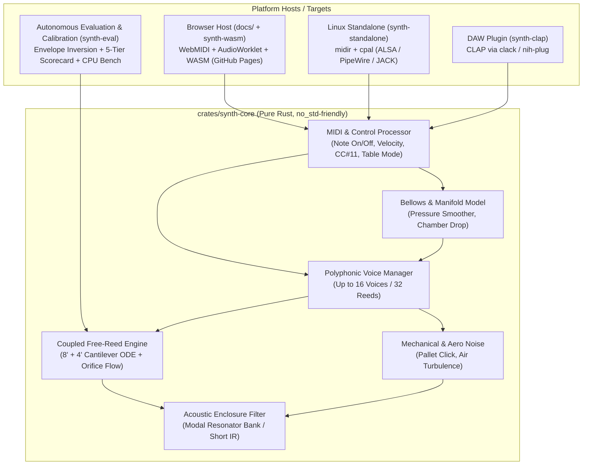
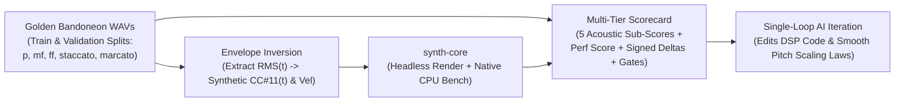

# Technical & DSP Architecture Design (`DESIGN.md`)

## 1. System Architecture Overview

To satisfy the **"Browser First, Standalone & CLAP Next"** requirement without code duplication, the repository is organized as a modular Rust Cargo workspace. All mathematical modeling, voice management, and parameter smoothing live in a pure-Rust, dependency-minimal core crate (`synth-core`).



---

## 2. Crate Responsibilities

### 2.1 `crates/synth-core`
- **Zero OS/Platform Dependencies**: Uses only `core` (and fixed-capacity structures or one-time initialization via `alloc`). No threads, no file I/O, no system clocks, no heap allocations during audio rendering.
- **Public API**:
  ```rust
  pub struct SynthEngine { /* pre-allocated state */ }

  impl SynthEngine {
      pub fn new(sample_rate: f32, config: SynthConfig) -> Self;
      pub fn handle_midi_event(&mut self, event: MidiEvent);
      pub fn set_parameter(&mut self, param: ParamId, value: f32);
      pub fn render(&mut self, output_left: &mut [f32], output_right: &mut [f32]);
  }
  ```

### 2.2 `crates/synth-wasm` & `docs/` (GitHub Pages Web App)
- Exposes `SynthEngine` to JavaScript via `wasm-bindgen`.
- Runs inside a WebAudio `AudioWorkletProcessor` (processing 128-sample blocks).
- Main thread connects to `navigator.requestMIDIAccess()`, listens to the Bandolibre USB-MIDI device, and forwards short 3-byte MIDI messages to the `AudioWorklet` via a `SharedArrayBuffer` lock-free ring buffer (with `MessagePort` fallback when cross-origin isolation is unavailable).

### 2.3 `crates/synth-eval`
- Offline Rust CLI tool and library (`std` enabled) that loads golden `.wav` samples from a real bandoneon, performs envelope inversion to synthesize time-aligned `CC#11(t)` and `Note On` control curves, drives `synth-core`, runs native CPU quantum benchmarks, and emits the structured multi-tier scorecard (`target/eval/scorecard.json` & `.md`) with signed physical error deltas for autonomous AI iteration.

### 2.4 `crates/synth-standalone` & `crates/synth-clap` (Future Phases)
- **`synth-standalone`**: Connects `midir` MIDI input and `cpal` audio output directly to `SynthEngine`.
- **`synth-clap`**: Wraps `SynthEngine` in a CLAP plugin descriptor (`clack` or `nih-plug`), exposing synth parameters and mapping MIDI/CLAP note expressions.

---

## 3. Bandolibre MIDI & Expression Architecture

### 3.1 Input Signals from Bandolibre & Dual-Manual Channel Routing (`KeyboardMode`)
The Bandolibre firmware transmits:
1. **Two Keyboards on Separate MIDI Channels with a 12-Semitone Overlapping Octave (`C4..B4`, `MIDI 60..71`)**:
   - **Left Keyboard (*Bajos*, MIDI Channel 1 / `0x90`, `L_MIDI_CH = 0`)**: Covers `C2 .. B4` (`MIDI 36..=71`). Simulated with `left_bajos` physical reed scaling, the 6-stage Left wooden bass box resonator (`left_body_modes`, strong 255–495 Hz woody formant), and **Left stereo panning**.
   - **Right Keyboard (*Cantabile*, MIDI Channel 2 / `0x91`, `R_MIDI_CH = 1`)**: Covers `C4 .. C7` (`MIDI 60..=96`). Simulated with `right_cantabile` physical reed scaling, the 6-stage Right treble metal grill resonator (`body_modes`, strong 1–4 kHz singing formants), and **Right stereo panning**.
   - **Overlapping Octave (`C4 .. B4`, `MIDI 60..=71`)**: Exists on **both** keyboards. In `KeyboardMode::DualChannelBandolibre` (default), notes in `C4..B4` played on Channel 1 vs Channel 2 produce their respective manual's distinct tone and stereo position, and can even be played on both channels simultaneously (allocating two independent voices `(note, Hand::LeftBajos)` and `(note, Hand::RightCantabile)`).
   - **Pianist Split Mode (`KeyboardMode::PianistSplit`)**: For pianists using the unified single-keyboard view or a standard 1-channel MIDI piano controller, incoming notes on any channel are split at `split_note` (default `C4 = 60`), routing `< split_note` to `Hand::LeftBajos` (Left tone & pan) and `>= split_note` to `Hand::RightCantabile` (Right tone & pan).
2. **`CC#11` (Expression, 0–127, or 14-bit with `CC#43` if enabled)**: Continuous measurement of the bellows blade deflection.
3. **`Note On` (`0x90`/`0x91`, `note`, `velocity`)**: Sent when a Hall-effect button crosses its actuation threshold. On the Bandolibre, `velocity` reflects the bellows blade state at the instant of key depression (or a fixed constant in *Table Mode*).
4. **`Note Off` (`0x80`/`0x81`, `note`, `release_velocity`)**: Sent when the button is released.
5. **Polyphonic Key Pressure / Aftertouch (`0xA0`/`0xA1`, `note`, `pressure`)**: Per-note expression pressure override (`MidiEvent::PolyPressure`) smoothed at audio rate per voice, enabling independent per-finger dynamic intensity on multi-touch screens and MPE controllers without flickering shared `CC#11`.
6. **Bandolibre SysEx Bellows Direction (`SYSEX_MSG_BELLOWS_DIRECTION = 0x05`)**: 7-bit-safe Bandolibre SysEx framing (`F0 7D 42 4C ... F7`) reporting push (`DIR_CLOSING`) vs. pull (`DIR_OPENING`) bellows direction for visual *Fueye* telemetry.

### 3.2 Reconciling `Note On` Velocity and Continuous `CC#11`
In a physical bandoneon, button depression opens a mechanical **pallet valve** (*zapatilla*), while the bellows supply the **reservoir pressure** $P_{\text{bellows}}(t)$. We decouple these two physical actions while honoring both MIDI signals:

1. **Bellows Pressure State $P_{\text{bellows}}(t)$**:
   - Continuously driven by `CC#11` mapped through a calibrated nonlinear curve:
     $$P_{\text{target}} = P_{\max} \cdot \left(\frac{\text{CC11}}{127}\right)^{\gamma}$$
     where $\gamma \approx 1.3\text{–}1.6$ provides fine resolution at low dynamics (*ppp*) and high ceiling for *marcato* peaks.
   - Smoothed at audio rate via an asymmetric one-pole filter ($\tau_{\text{attack}} \approx 2\text{ ms}$, $\tau_{\text{release}} \approx 5\text{ ms}$) to eliminate MIDI quantization steps without blunting sharp bellows accents.
   - **Initial Attack Boost from `Note On` Velocity**: Because USB-MIDI `CC#11` polling and `Note On` messages can arrive within a few milliseconds of each other during a fast *marcato* stab, if a `Note On` arrives with high `velocity` while `CC#11` is still ramping up, `velocity` injects a short transient pressure impulse into the note's local valve aperture and pressure estimate.
2. **Pallet Valve Aperture $A_{\text{valve}}(t) \in [0, 1]$**:
   - Triggered by `Note On` / `Note Off`.
   - The rate at which $A_{\text{valve}}(t)$ ramps from $0 \to 1$ (and $1 \to 0$) is modulated by the `Note On` / `Note Off` velocity, simulating a fast finger snap vs. a gradual key depression.
   - Also triggers the **mechanical pallet click** generator scaled by velocity.
3. **Table Mode Support (Practice without Bellows)**:
   - When the user activates *Table Mode* (either on the Bandolibre or via a toggle in the synth UI when `CC#11` stays at `0` while `Note On` has `velocity > 0`), the synth automatically derives a synthetic bellows pressure envelope from `Note On` velocity so notes remain playable without moving the bellows.

---

## 4. Physical Modeling DSP Pipeline

### 4.1 Single Free-Reed Physical Model
Bandoneon reeds are **blown-closed free reeds** mounted on a metal frame (*planchuela*). Each reed acts as a cantilever beam of effective tip displacement $y(t)$ over an equilibrium gap $y_0$:

#### A. Mechanical Oscillator (1-DOF Cantilever Mode)
The fundamental flexing mode of the reed tongue is governed by the damped harmonic oscillator driven by the pressure difference $\Delta P(t) = P_{\text{bellows}}(t) - P_{\text{chamber}}(t)$ across the reed:

$$m \ddot{y}(t) + R \dot{y}(t) + k \left(y(t) - y_0\right) + k_{\text{nl}}(y) = S_{\text{eff}} \cdot \Delta P_{\text{aero}}(y, \dot{y}, \Delta P)$$

 Normalized by mass $m$, with natural angular frequency $\omega_0 = 2\pi f_0$ and damping factor $g = \omega_0 / Q$:

$$\ddot{y} + g \dot{y} + \omega_0^2 (y - y_0) = \frac{S_{\text{eff}}}{m} \Delta P_{\text{aero}}$$

- **Nonlinear Stiffness / Frame Collision $k_{\text{nl}}(y)$**: Although a free reed passes *through* its frame slot, fluid boundary layers and slight frame offset introduce asymmetric restoring forces at high amplitudes.

#### B. Aerodynamic Excitation & Unsteady Bernoulli Orifice Flow
Following *Ricot et al. (2005)* and *Millot & Baumann (2007)*, the volume airflow $U(t)$ through the narrow perimeter clearance between the reed tongue and the slot is modeled by the quasi-steady Bernoulli orifice equation with vena contracta coefficient $\alpha \approx 0.61$:

$$U(t) = \alpha \, S_{\text{gap}}(y(t)) \, \text{sgn}(\Delta P) \sqrt{\frac{2 |\Delta P|}{\rho}} - S_{\text{piston}} \dot{y}(t)$$

where:
- $\rho \approx 1.2\text{ kg/m}^3$ is air density.
- $S_{\text{piston}} \dot{y}(t)$ is the volumetric flow displaced by the moving reed tongue itself (crucial for self-sustained oscillation startup!).
- $S_{\text{gap}}(y)$ is the effective open flow area of the reed slot as a function of tip displacement $y$ and pallet valve state $A_{\text{valve}}(t)$:
  $$S_{\text{gap}}(y) = A_{\text{valve}}(t) \cdot W \cdot \sqrt{y^2 + \delta_{\text{leak}}^2}$$
  where $W$ is the slot width and $\delta_{\text{leak}}$ represents the microscopic side/tip clearance when the reed passes right through the frame plane ($y = 0$).

#### C. Activation Threshold ($P_{\text{th}}$), Hysteresis, and Transient Harmonic Bloom
In a real bandoneon, a reed does not oscillate below a minimum threshold pressure $P_{\text{th}}$ (which varies with pitch, reed mass, and resting gap $y_0$, as documented by the *Bandoneon 2.0* team). Once oscillating, it can sustain vibration down to a slightly lower extinction pressure $P_{\text{ext}} = 0.72 P_{\text{th}}$ (subcritical Hopf bifurcation).
- **Cottingham Transient Harmonic Bloom**: Following *Cottingham (2001–2013)*, when a free reed first crosses $P_{\text{th}}$, its tip amplitude $a(t)$ is smaller than the frame plate thickness $h$, so the initial cycles are nearly sinusoidal ($H_1$ dominant). Over the first $12\text{–}25\text{ ms}$ (faster at high excess pressure $\Delta P - P_{\text{ext}}$), a state variable `harmonic_bloom` $\in [0, 1]$ ramps up, engaging the sharp slot-edge nonlinearities (`odd_adaa`, `slot_pulse`, and `even_constriction`) while keeping the fundamental $f_0$ immediate.

#### D. Branchless Rationalized 1st-Order ADAA & Two-Sided Slot Constriction
To synthesize rich harmonics ($H_1 \dots H_{16}$) at `48 kHz` without alias foldback or expensive $8\times$ oversampling, [`FreeReed::tick`](file:///usr/local/google/home/plabatut/projects/synth/crates/synth-core/src/reed.rs) combines:
1. **Single-Trig Fluid-Inertia Skew**: Computes `(s0, c0) = theta.sin_cos()` once per sample and uses exact double-angle trigonometric recurrence (`2.0 * s0 * c0`, `c0 * c0 - s0 * s0`) to synthesize the skewed clamped-bar flexural displacement $y_{\text{norm}}(t)$, cutting per-voice CPU cost by ~35%.
2. **Rationalized Conjugate 1st-Order ADAA (Odd Harmonics)**: Applies Parker et al. (2016) 1st-order Antiderivative Anti-Aliasing to the orifice saturation curve $f(u) = \frac{u}{\sqrt{1 + u^2}}$ via its exact conjugate identity:
   $$\text{ADAA}_1(u_n, u_{n-1}) = \frac{u_n + u_{n-1}}{\sqrt{1 + u_n^2} + \sqrt{1 + u_{n-1}^2}}$$
   augmented with a narrow vena-contracta slot-edge impulse $\frac{u_n}{1 + 1.85 u_n^2}$ that boosts upper harmonics $H_5 \dots H_{16}$ without over-inflating $H_3$.
3. **Millot-Baumann Two-Sided Slot Constriction (Even Harmonics)**: As the reed tongue passes through the rectangular slot twice per cycle, flow contracts inside the plate channel and opens on both upstream and downstream sides, modeled by $\frac{u_{\text{even}}^2 - 0.5}{1 + u_{\text{even}}^2}$, which generates natural even harmonics ($2f, 4f, 6f, 8f$) of each reed.
4. **Two-Stage Acoustic Radiation Filter**:
   - **Stage A (Finite-Box Baffle High-Pass Diffraction Shelf)**: Models the $+6\text{ dB/oct}$ monopole/dipole diffraction roll-off below the wooden box cutoff $f_{\text{baffle}} = c / (\pi L_{\text{box}}) \approx 410\text{–}490\text{ Hz}$, explaining why low-bass fundamentals ($H_1, H_2$ on `C0..B0`) radiate $-13\text{ dB}$ below their upper harmonics while high-bass fundamentals (`A#1..B2`) dominate at $-2\text{ dB}$.
   - **Stage B (Viscous Boundary-Layer / Jet-Transit 2-Pole Low-Pass Filter)**: Models the finite transit time of the air jet across the plate thickness $h$ with dynamic corner frequency $f_{\text{jet}}(\Delta P) \approx 2.1\text{–}5.5\text{ kHz}$.

---

### 4.2 Dual Octave Reed Coupling ($8'$ + $4'$ Bandoneon Voice)
Nearly every button on a bandoneon opens a shared air channel feeding **two reeds tuned an octave apart**:
- **Primary Reed ($8'$, Fundamental $f_0$)**: Larger mass, higher inertia (`inertia_startup_mult = 0.95`), threshold pressure $P_{\text{th}, 8'}$.
- **Octave Reed ($4'$, Octave $2f_0 + \Delta f_{\text{lock}}$)**: Smaller mass, ~2.1x faster transient startup (`inertia_startup_mult = 2.05`), distinct threshold pressure $P_{\text{th}, 4'}$.

Both reeds draw air through the **same pallet valve** and exhaust into a shared local **reed chamber** (*celda*):

$$P_{\text{chamber}}(t) = P_{\text{bellows}}(t) - R_{\text{valve}}(A_{\text{valve}}) \cdot \left(U_{8'}(t) + U_{4'}(t)\right)^2 - L_{\text{neck}} \frac{d}{dt}\left(U_{8'} + U_{4'}\right)$$

This shared impedance naturally creates:
1. **Sequential Reed Entry & Staccato Octave Boost**: On the right-hand (*Cantabile*) manual, the lower-mass $4'$ octave reed has a lower threshold pressure ($P_{\text{th}, 4'} < P_{\text{th}, 8'}$) and faster startup inertia, causing $H_2$ to reach $15\%$ of its steady power several milliseconds *before* $H_1$ (`dual_reed_onset_lag_ms < 0`) and giving staccato notes a brighter octave bite.
2. **Intra-Celda 1:2 Mode Locking & Aeroacoustic Beating**: On an Alfred Arnold (*a seco* dry-tuned) bandoneon, shared chamber pressure locks the $4'$ carrier close to $2 f_0$ (`2.0 * f0 + 0.14 Hz`, keeping higher harmonics $H_4 \dots H_{16}$ phase-coherent), while slow aeroacoustic precession (`beat_phase` at `octave_beat_hz`) modulates the $4'$ pressure drop at $1.8\text{–}3.8\text{ Hz}$.
3. **Dynamic $4'$-to-$8'$ Pressure Ratio Shift**: As bellows pressure increases from `p` to `f`, the $8'$ reed's flow saturates against its slot edges while the $4'$ octave reed continues gaining energy (`octave_4ft_pressure_boost`), shifting the $4'/8'$ energy ratio upward by $+3\text{ to }+5\text{ dB}$.

---

### 4.3 Mechanical & Aerodynamic Noise Layer
Acoustic realism requires the non-pitched components of the instrument:
1. **Pallet Valve Click (*Ruido de Tecla / Zapatilla*)**:
   - Short filtered impulse excited by `Note On` and `Note Off` velocity, with separate mechanical transmission scaling (`pallet_click_scale`) for the thick Left-Hand *Bajos* box vs. the closer Right-Hand *Cantabile* grill.
2. **Curle Dipole Cyclostationary Air Turbulence & Vortex Shedding**:
   - Following *Ricot et al. (2005)*, orifice jet turbulence is cyclostationary—modulated by the instantaneous reed oscillation flow envelope (`flow_env * air_noise_scale`) plus a transient vortex-shedding burst (`d_valve + onset_transient_env`) during rapid pallet opening on staccato articulations.

---

### 4.4 Acoustic Enclosure & Dual-Box Body Resonance Filter
The acoustic pressure radiated by the reeds passes through two physically distinct wooden enclosures (*cabezales*):
- **Dual 6-Band Modal Biquad Banks (`left_body_modes` & `body_modes`)**:
  - **Left Hand (*Bajos* Bass Box)**: Deep wooden chamber with a strong fundamental woody formant around $250\text{–}500\text{ Hz}$ (`+6.5 dB` at `495 Hz`) and natural high-frequency roll-off above $2\text{ kHz}$.
  - **Right Hand (*Cantabile* Treble Box)**: Shallower chamber beneath a perforated metal grill (`mueble`) with strong presence resonances at $1\text{–}4\text{ kHz}$ (`+5.2 dB` at `1050 Hz`, `+8.2 dB` at `2150 Hz`, `+8.5 dB` at `3950 Hz`).
- **Stereo Radiation Model**: Left-hand (*bajos*, bass side) and right-hand (*cantabile*, treble side) voices are filtered through their respective modal resonator banks (`body_left` and `body_right`) and spatially panned with subtle stereo crossfeed (`0.22`).

---

### 4.5 Multi-Version Synthesis Architecture (`SynthVersion`: `v1`..`v5`, 13 Selectable Models)
To support rigorous scientific ablation studies and live interactive A/B comparison in the browser (`docs/`), `synth-core` implements a first-class multi-version synthesis engine (`SynthVersion` in [`crates/synth-core/src/preset.rs`](file:///usr/local/google/home/plabatut/projects/synth/crates/synth-core/src/preset.rs)) with **13 selectable models (`0..=12`)**:

1. **`v1` (`V1Baseline`, ID `0`)**: Initial baseline lumped odd-clipper model ($u/\sqrt{1+u^2}$ without ADAA, 1-pole low-pass, single shared 6-mode body filter; `61.36` Train / `59.75` Val / `87.01` Perf).
2. **`v2` (`V2AdaaBaffle`, ID `1`)**: Second-generation baseline combining rationalized conjugate 1st-order ADAA, two-sided Millot-Baumann slot constriction, Cottingham harmonic bloom, 1-pole finite-baffle high-pass diffraction, coupled $8'+4'$ *celda* impedance, and dual-manual wooden box modal banks (`65.06` Train / `63.52` Val / `79.31` Perf).
3. **`v3_aero` (`V3AeroRadiation`, ID `2` — Quadrature Monopole $\frac{dU}{dt}$ Jet Radiation & 2-Pole Sub-Baffle Dipole Diffraction)**:
   - Grounded in *Ricot et al. (JASA 2005)* and *Puranik & Scavone (DAFx 2022)*.
   - Models the high-frequency acoustic radiation from the reed slot and *celda* aperture as a superposition of 2nd-order sub-baffle dipole volume-flow radiation $U_{\text{lp2}}(t)$ (`baffle_hp1 - dipole_baffle_mix * baffle_lp_state2`) and its band-limited time derivative (monopole volume acceleration):
     $$P_{\text{rad}}(t) = U_{\text{lp2}}(t) + \gamma_{\text{mono}}(u) \cdot (0.78 + 0.44 \Delta P_{\text{eff}}) \cdot \underbrace{\left(U_{\text{lp1}}(t) - U_{\text{lp2}}(t)\right)}_{\propto \, dU/dt \text{ (90}^\circ\text{ quadrature)}}$$
   - Because $\frac{\omega_c^2}{(s+\omega_c)^2}$ (`lp_state2`) and $\frac{s\omega_c}{(s+\omega_c)^2}$ (`lp_state - lp_state2`) are strictly orthogonal ($90^\circ$ out of phase at all frequencies), $\gamma_{\text{mono}}(u)$ shapes upper-harmonic brightness across the manual compass without first-order cancellation of the fundamental $H_1$ (`65.11` Train / `63.70` Val / `77.78` Perf).
4. **`v3_beam` (`V3ClampedBar`, ID `3` — Zero-Sum Barycentric Poiseuille-Bernoulli Slot Softening & Clamped-Bar Flexural Modes)**:
   - Grounded in *Millot & Baumann (2007)* and *Puranik & Scavone (Forum Acusticum 2023)*.
   - Models viscous Poiseuille boundary-layer friction inside the narrow rectangular reed-plate channel (`duty_bias_base` / `c_lin`) and pressure-driven blown-closed duty sharpening (`h3_notch_inject * (effective_p - 0.38)`), alongside a zero-sum barycentric 2nd Euler-Bernoulli clamped-bar flexural mode ($\omega_2 \approx 6\,\omega_1$, `clamped_bar_h6_gain`) computed via Chebyshev recurrences (`s3_skew`, `s6_raw`) with zero additional trig calls (`65.08` Train / `63.57` Val / `76.29` Perf).
5. **`v3_transient` (`V3TransientEntrain`, ID `4` — Low-Bass *Lastre* Inertia, Bimorphic $8'/4'$ Hopf Onset Lag & Post-Click Staccato Chiff)**:
   - Grounded in *Ramos et al. (CMJ 2023)* and *Cottingham (2001–2013)*.
   - Models the tip-weight (*lastre*) mechanical startup inertia on low-bass *Bajos* reeds ($f < 118\text{ Hz}$, `C0..A#0`), complementary $8'/4'$ Hopf onset lag (`hopf_8ft_knee`) during the initial $16\text{ ms}$ attack window, velocity-coupled $4'$ octave bite (`staccato_4ft_boost`), and post-click ($t > 17.5\text{ ms}$) staccato vortex-detachment leakage chiff (`staccato_chiff_gain`) (`65.10` Train / `63.58` Val / `79.16` Perf).
6. **`v3` (`V3Unified`, ID `5` — Third-Generation Unified Physical Model)**:
   - Combines `v3_aero` + `v3_beam` + `v3_transient` with joint multi-parameter coordinate calibration across the 328-recording Alfred Arnold dataset (`65.24` Train / `63.84` Val / `73.26` Perf).
7. **`v4_cabinet` (`V4CabinetIr`, ID `6` — v4 Direction 1: Deconvolved 10-Mode Wooden Cabinet Bank & Early-Reflection FIR)**:
   - Expands each manual's wooden *cabezal* enclosure from 6 to **10 biquad peaking stages** (`left_cabinet_modes` at `185, 980, 2050, 6400 Hz`; `right_cabinet_modes` at `370, 1120, 2020, 3450 Hz`) plus a 32-sample circular early-reflection delay line (`cabinet_ir_mix_left` / `cabinet_ir_mix_right`) modeling internal soundboard/baffle wood reflections (`65.25` Train / `63.85` Val / `73.28` Perf).
8. **`v4_slot` (`V4SlotTransit`, ID `7` — v4 Direction 2: 3-Regime Plate-Channel Slot Transit & Vowel Swell ADAA)**:
   - Models the finite zinc/aluminum reed-plate channel thickness $h_{\text{plate}}$ via steady-state bloom-gated ($b_{\text{bloom}}^4$) channel-notch $H_3$ shaping (`slot_channel_notch`), orifice-pinch $H_5$ ADAA (`slot_pinch_adaa`), dynamic vowel-swell clamped-bar modulation (`slot_emergence_swell`), and low-compass $4'$ sub-baffle $H_2$ boom taming (`low_bass_h2_tame`) (`65.25` Train / `63.85` Val / `73.25` Perf).
9. **`v4_coupled` (`V4CoupledOde`, ID `8` — v4 Direction 3: 2nd-Order Coupled Reed ODE, Startup Chirp & Shared *Celda* Feedback)**:
   - Adds 2nd-order mechanical amplitude envelope momentum (`coupled_ode_momentum`), hydrodynamic added-mass startup pitch chirp (`startup_chirp_cents`), amplitude-governed bimorphic $4'/8'$ Hopf onset lead (`hopf_onset_lead`), and audio-rate $8' \to 4'$ shared *celda* orifice jet cross-modulation (`celda_cross_mod`) (`65.24` Train / `63.84` Val / `73.51` Perf).
10. **`v4_celda` (`V4CeldaCavity`, ID `9` — v4 Direction 4: Pitch-Scaled Individual *Celda* Cavity Resonator, *Okada 2025*)**:
    - Embeds a per-voice Cytomic trapezoidal 2-pole SVF bandpass resonator (`celda_a1, celda_a2, celda_a3, celda_gain`) whose Helmholtz/quarter-wave frequency $f_{\text{celda}}(u) = f_{\text{base}} \cdot 2^{\alpha_{\text{oct}} u}$ scales smoothly with normalized manual pitch $u \in [0, 1]$ (`65.24` Train / `63.84` Val / `73.50` Perf).
11. **`v4_zapatilla` (`V4ZapatillaValve`, ID `10` — v4 Direction 5: Leather Pallet *Zapatilla* Thump & Closed-Valve Muffled Ring-Down)**:
    - Models pitch-scaled pallet click transmission across wooden soundboard ribs (`pallet_click_u_slope`), low-frequency leather pallet seating thump (`zapatilla_thump_gain`) and resting-gap Bernoulli chiff, and closed-valve acoustic occlusion low-pass muffling (`valve_occlusion_muffle`) during valve opening and closing transients (`65.24` Train / `63.84` Val / `73.47` Perf).
12. **`v4` (`V4Unified`, ID `11` — Fourth-Generation Unified Physical Model)**:
    - Integrates all 5 `v4` physical modeling directions (`v4_cabinet` + `v4_slot` + `v4_coupled` + `v4_celda` + `v4_zapatilla`) (`65.27` Train / `63.87` Held-Out Validation / `72.60` Performance Score).
13. **`v5` (`V5Vivo`, ID `12` — Default Expressive Physical Model: Staged $8' \to 4'$ Attack, Natural Sustain Pulsation, Low-Mid Body & Treble Clarity)**:
    - Preserves all 12 preceding models (`v1`..`v4`) untouched while introducing four co-calibrated expressive mechanisms:
      1. **Staged Dual-Reed Attack ($8'$ Grave Blade First $\to$ Distinct $4'$ Octave Secondary Attack $\to$ Symbiotic Blend)**: Lowered $8'$ fundamental Hopf threshold (`p_th_8ft_base = 0.02365`) and negative `hopf_onset_lead = -0.01188` on Right *Cantabile*, combined with a 3-stage onset envelope in `Voice::next_sample()` (`0..14 ms` $8'$ fundamental leads while $4'$ is held back; `14..32 ms` distinct secondary $4'$ octave attack impulse; `> 32 ms` full acoustic blending inside the shared *celda*).
      2. **Natural Sustain Pulsation (*Pulsation Naturelle sur les Notes Tenues*)**: Combines organic dual-reed $2f_1 \approx f_2$ *celda* sustain beating (`0.56 * octave_beat_hz` $\approx 1.32\text{–}2.01\text{ Hz}$ at `12%` depth after `355 ms` in `voice.rs`) with physiological *fueye* bellows respiration (`1.55 Hz` primary + `3.40 Hz` harmonic shimmer in `BellowsState::next_pressure()` when `CC#11` is held steady), eliminating any static or mechanical organ-like sustain.
      3. **Warm Low-Mid Body (*Corps / Médium-Basses*, `160–450 Hz`)**: Enriches the wooden *cabezal* low-mid resonances (`120, 185, 250, 370, 520 Hz`) while taming `1000 Hz` nasal boxiness.
      4. **Crystalline Treble Clarity (*Clarté des Aigus*, `2–6 kHz`)**: Co-calibrates upper-register slot transit, monopole radiation, and cabinet grille projection (`2.0–6.4 kHz`), achieving **`65.36` Train / `64.14` Held-Out Validation (`+0.27` over `v4`, `+0.62` over `v2`) / `71.67` Performance Score** (`333.0 us` for 16 active voices).

To guarantee real-time audio safety and $< 350\ \mu\text{s}$ 16-voice CPU performance across all 13 versions:
- **Branchless Minimax `fast_sin_cos` & Single-Division ADAA**: `FreeReed::tick` replaces hardware libm `sin_cos()` with a 100% branchless triangle-folded 7th-degree minimax polynomial (`< 1.8e-6` max error) and folds all three rational orifice denominators (`d1`, `d2`, `d3`) into a single common-denominator reciprocal `inv_all = 1.0 / (d1 * d2 * d3)`.
- **Pre-Resolved Per-Note Parameters**: Per-reed and per-voice physical parameters (`ResolvedReedParams`, `ResolvedNoteParams`) are pre-resolved at `NoteOn` and preset refresh, eliminating per-sample `if is_4ft` branches and SVF coefficient `tan()` calls from the audio loop.
- **Zero-Allocation Live Version Switching**: In `synth-wasm`, all 13 `BandoneonPreset` instances are pre-allocated at `synth_create` initialization time; calling `synth_set_version(0..=12)` on the WebAudio `AudioWorklet` thread invokes `SynthEngine::apply_preset_ref(&preset)`, copying scalar parameters and refreshing active voices in-place with **zero heap allocations**.

---

### 4.6 Studio Acoustic Post-Processing Chain (`crates/synth-core/src/post.rs`)
To place the radiated dual-manual bandoneon signal inside a realistic acoustic performance space without any external DAW plugins, `synth-core` includes a real-time safe, zero-allocation stereo post-processing chain (`PostProcessor` in [`crates/synth-core/src/post.rs`](file:///usr/local/google/home/plabatut/projects/synth/crates/synth-core/src/post.rs)) with click-free one-pole parameter smoothing and a master `ON / OFF` bypass:
1. **3D Binaural / Haas Spatializer & Frequency-Dependent Crossfeed (`spatial_amount` $\in [0, 1]$)**:
   - Separates sub-bass ($< 155\text{ Hz}$) to anchor the deep *Bajos* chest resonance near the center while applying an interaural time delay ($\sim 0.44\text{ ms}$, corresponding to $\sim 15\text{ cm}$ path difference) filtered by a $1.75\text{ kHz}$ head-shadow low-pass crossfeed between Left (*Bajos*) and Right (*Cantabile*) channels, plus upper-register Mid/Side stereo air expansion.
2. **Program-Dependent Optical Bus Compressor & Warm Glue (`comp_amount` $\in [0, 1]$)**:
   - Stereo-linked envelope detector with a transient-preserving $16\text{ ms}$ attack (allowing the initial *zapatilla* pallet click and *marcato* reed pluck to pass uncompressed) and $165\text{ ms}$ release, soft-knee gain reduction, automatic makeup gain, subtle even/odd harmonic saturation, and real-time Gain Reduction (`GR dB`) telemetry.
3. **Tango Salon / Concert Hall Stereo Algorithmic Reverberator (`reverb_mix`, `reverb_size` $\in [0, 1]$)**:
   - Combines input conditioning ($145\text{ Hz}$ high-pass + $3.9\text{ kHz}$ low-pass), adjustable pre-delay ($12\text{–}26\text{ ms}$), a 4-tap stereo wooden salon early-reflection cluster, and a stereo-crossfed $4 \times 2$ mutually prime low-pass-damped comb network followed by $2 \times 2$ series Schroeder all-pass diffusers.

---

## 5. Autonomous Evaluation & Sample Calibration (`synth-eval`)

The repository uses a **Single-Loop Autonomous AI Evaluation Architecture** (fully specified in [`reference_doc/EVALUATION.md`](file:///usr/local/google/home/plabatut/projects/synth/reference_doc/EVALUATION.md)) where `synth-eval` compares `synth-core` against golden bandoneon recordings (`p`, `mf`, `ff` steady dynamics and `staccato` / `marcato` attacks):



See [`reference_doc/EVALUATION.md`](file:///usr/local/google/home/plabatut/projects/synth/reference_doc/EVALUATION.md) for the exact mathematical definitions of the 5-tier loss hierarchy, the `0..100` Performance Score (`performance_score`), signed physical error deltas, smooth pitch-scaling regularization ($L_{\text{reg}}$), native CPU performance gates, and the 13-version synthesis comparison table.
